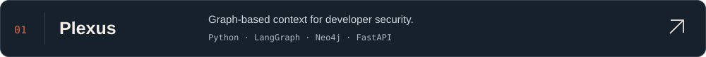
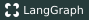

<picture>
  <source media="(prefers-color-scheme: dark)" srcset="./assets/header-dark.svg">
  
</picture>

 

### About

<picture>
  <source media="(prefers-color-scheme: dark)" srcset="./assets/activity-dark.svg?v=balanced-450-fast-v3">
  
</picture>

### Selected projects

### Tech stack

**Languages & frontend**  

**Backend, data & delivery**  

**AI & retrieval**  
      

**Additional tools**  
    

### Contributions

<picture>
  <source media="(prefers-color-scheme: dark)" srcset="https://raw.githubusercontent.com/priy-anshugupta/priy-anshugupta/output/github-contribution-grid-snake-dark.svg">
  
</picture>

 

  <em>“Most of the people who've made beautiful things seem to have done it by fixing something that they thought ugly.”</em> 
  — <a href="https://www.paulgraham.com/taste.html">Paul Graham</a>

